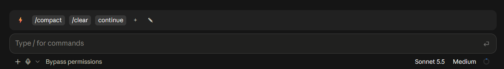
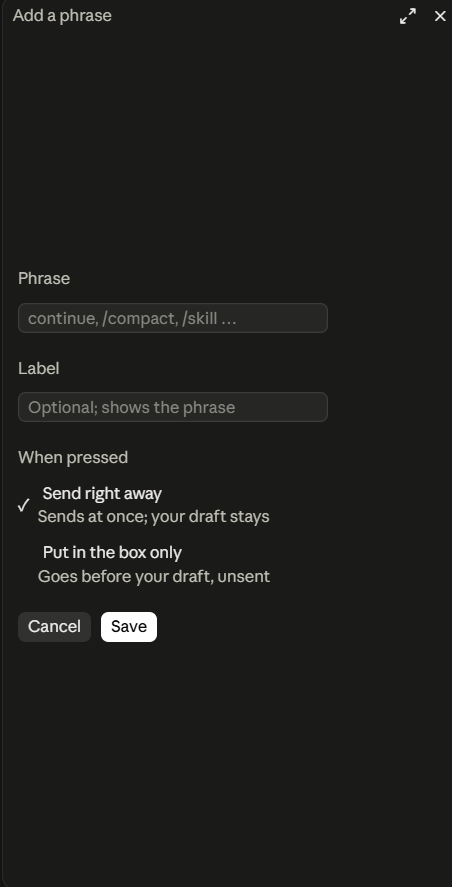

# quickbar

A row of phrase buttons above the prompt box in the Claude desktop app's **Code** tab. One click types a phrase you use often into the session in front of you, as if you had typed it yourself: plain words such as `continue`, a slash command such as `/compact`, or a `/skill` followed by a sentence of what you want.



quickbar is a Claude Code plugin: Claude Code draws the buttons with its own parts, so they look like the rest of the Code tab in light and dark themes.

> [!IMPORTANT]
> **Unofficial.** quickbar is a third-party plugin, not made, endorsed or supported by Anthropic. It uses Claude Code's plugin hooks, which are still young, so an update to Claude may break it at any time.

## Requirements

- The Claude desktop app, Code tab. The terminal version of Claude Code may work but is not supported.
- Claude Code 2.1.286 or later. Below 2.1.287 plugin hooks are off by default: add this to `%USERPROFILE%\.claude\settings.json` (keep whatever else is there), then start a new session.

  ```json
  {
    "env": {
      "CLAUDE_CODE_ENABLE_FUNCTION_HOOKS": "1"
    }
  }
  ```

  The desktop app's Claude Code version is the folder name under `%APPDATA%\Claude\claude-code\`.

## Install

Run these two commands with the `claude` CLI. If you only have the desktop app, use the copy it ships: `%APPDATA%\Claude\claude-code\<version>\<hash>\claude.exe`.

```bash
claude plugin marketplace add seosy218-ops/claude-quickbar
```

```bash
claude plugin install quickbar@quickbar
```

Then open a new session in the Code tab. The bar shows above the prompt box.

## Use

- **Click a phrase** to type it into the session. A slash command runs as if typed; plain words are sent. Whatever you had half-typed in the prompt box stays there.
- **`+`** adds a phrase: the text to type (anything you would type yourself, e.g. `continue` or `/compact keep the plan`), an optional label for the button, and what a click does: **Send right away**, or **Put in the box only**, which puts the phrase in the prompt box ahead of your draft for you to finish and send.

  
- **✎** turns on edit mode. There, clicking a phrase selects it instead of sending it, and four buttons act on the selection: **◀ ▶** move it, **✎** edits it, **✕** deletes it. **Done** leaves edit mode.

The first session starts with `/compact`, `/clear` and `continue`. Your phrases are kept in `%USERPROFILE%\.claude\plugins\store\` and are the same in every session and project.

## SSH and WSL sessions

By default the bar does not show in a session on an SSH host, WSL included. When the desktop app starts such a session it copies your Windows plugins to the host (under `~/.claude/remote/plugins/`) and leaves out their `hooks/` folder on purpose, and that folder is where quickbar draws its bar. The copy is also named `quickbar`, so it hides a `quickbar@quickbar` installed on the host.

The fix is a second copy of quickbar under another name, installed on the host. This has been checked with WSL as the host; the commands run inside it. First install quickbar there with the host's `claude` (the desktop app keeps one at `~/.claude/remote/ccd-cli/<version>`, the examples below call it `claude`):

```bash
claude plugin marketplace add seosy218-ops/claude-quickbar
claude plugin install quickbar@quickbar
```

Then make the renamed copy from the installed one. It changes the plugin name, the owner of each piece of bar state (without this the plugin fails to load), and adds a small marketplace around it:

```bash
src=$(ls -d ~/.claude/plugins/cache/quickbar/quickbar/*/ | sort -V | tail -1)
mkdir -p ~/.claude/quickbar-wsl/.claude-plugin
rm -rf ~/.claude/quickbar-wsl/quickbar-wsl
cp -r "$src" ~/.claude/quickbar-wsl/quickbar-wsl
cd ~/.claude/quickbar-wsl/quickbar-wsl
sed -i 's/"name": "quickbar"/"name": "quickbar-wsl"/' .claude-plugin/plugin.json
sed -i "s/plugin: 'quickbar'/plugin: 'quickbar-wsl'/g" hooks/register.tsx
sed -i 's/^\(\s*\)quickbar: {/\1"quickbar-wsl": {/' types/index.d.ts
cat > ../.claude-plugin/marketplace.json <<'JSON'
{
  "name": "quickbar-wsl",
  "owner": { "name": "local" },
  "plugins": [{ "name": "quickbar-wsl", "source": "./quickbar-wsl", "description": "quickbar for SSH sessions" }]
}
JSON
```

Install it, then start a new SSH session in the Code tab:

```bash
claude plugin marketplace add ~/.claude/quickbar-wsl
claude plugin install quickbar-wsl@quickbar-wsl
```

Things to know:

- Phrases on the host are kept apart from the ones on Windows. Add them again with `+`.
- The renamed copy does not follow quickbar's updates. After upgrading quickbar on the host, run the second block again, then `claude plugin update quickbar-wsl@quickbar-wsl`.
- If a later version of the desktop app copies `hooks/` too, you will see two bars. Remove the extra copy then: `claude plugin uninstall quickbar-wsl@quickbar-wsl`.

## Upgrading from the exe version

quickbar 0.2 and earlier was a separate `quickbar.exe`. The plugin replaces it and does not read its settings, so add your phrases again with `+`. To remove the exe:

1. In its tray icon (a ⚡ in the notification area), untick **Start with Windows**, then **Quit**.
2. Delete `quickbar.exe` and `%APPDATA%\quickbar\`.

## Turn off or uninstall

Disable or remove it in `/plugin`, or with the CLI:

```bash
claude plugin uninstall quickbar@quickbar
```

Uninstalling leaves your saved phrases in `%USERPROFILE%\.claude\plugins\store\`; delete quickbar's file there to forget them.

## License

[MIT](LICENSE)
